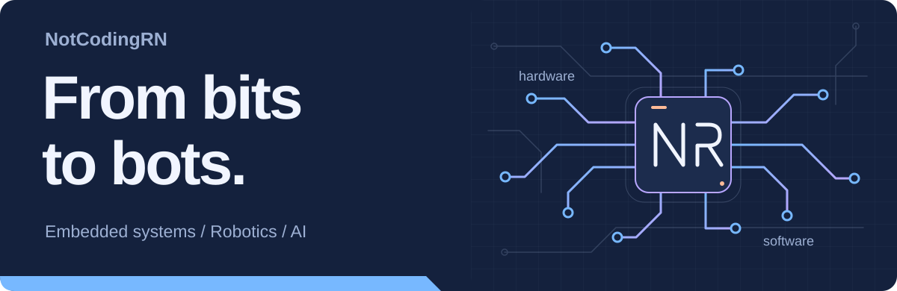

  

# Hey, I'm Alaa.

**CTO at [ORBIQ](https://www.orbiq.team/)** and an engineering student at **Zewail City**. I work across embedded systems, robotics, and machine learning, from PIC drivers and analog circuits to AI companions.

[LinkedIn](https://www.linkedin.com/in/alaayvl/) &nbsp; / &nbsp; [ORBIQ](https://www.orbiq.team/) &nbsp; / &nbsp; [All repositories](https://github.com/NotCodingRN?tab=repositories)

## What I'm building

At **[ORBIQ](https://www.orbiq.team/)**, we're building AI companions that adapt to each learner.

- **Swaya** helps children in special education practise speech and social skills.
- **MADA** is an AI study assistant for university students.

On my bench: **Sentinile**, an EGX stock prediction project combining time-series forecasting with LLM news sentiment. Private, in progress.

## Selected projects

<table>
<tr>
<td width="50%" valign="top">
<h3><a href="https://github.com/NotCodingRN/IROS-Minesweeper-Robot">IROS Minesweeper Robot</a></h3>

Firmware for an autonomous minesweeper robot. Where code meets the physical world.

C++ &nbsp; / &nbsp; Robotics &nbsp; / &nbsp; Embedded systems

</td>
<td width="50%" valign="top">
<h3><a href="https://github.com/NotCodingRN/solidworks-skill">solidworks-skill</a></h3>

A Claude Code plugin for parts, assemblies, drawings, FEA and Motion in SOLIDWORKS, checked against hand calculations.

C# &nbsp; / &nbsp; CAD automation &nbsp; / &nbsp; Engineering

</td>
</tr>
<tr>
<td width="50%" valign="top">
<h3><a href="https://github.com/NotCodingRN/dormvpn">dormvpn</a></h3>

A self-hosted, multi-user VPN on AWS with per-user data limits, an admin panel, and a Windows app.

C# &nbsp; / &nbsp; AWS &nbsp; / &nbsp; VLESS + REALITY

</td>
<td width="50%" valign="top">
<h3><a href="https://github.com/NotCodingRN/shannon-says">shannon-says</a></h3>

A communications-engineering CLI for channel capacity, dB math, path loss, link budgets, and Eb/N0.

Python &nbsp; / &nbsp; Information theory &nbsp; / &nbsp; RF

</td>
</tr>
</table>

<b>More projects, from circuits to cloud</b>

### Embedded and hardware

| Project | What it is |
| --- | --- |
| [ES_Course_Labs](https://github.com/NotCodingRN/ES_Course_Labs) | PIC embedded labs with structured HAL/MCAL drivers |
| [Full-Smart-Home-Safety-System](https://github.com/NotCodingRN/Full-Smart-Home-Safety-System) | Smart home safety system in Python |
| [Distortion-Guitar-Pedal](https://github.com/NotCodingRN/Distortion-Guitar-Pedal) | DIY distortion pedal |
| [UN1CA](https://github.com/NotCodingRN/UN1CA) | Custom firmware for Samsung Galaxy devices (fork) |

### Software

| Project | What it is |
| --- | --- |
| [campus-lost-found](https://github.com/NotCodingRN/campus-lost-found) | Three-tier Docker Compose app: Nginx/React, Express, PostgreSQL |
| [Food-Factory-Shop-Management-System](https://github.com/NotCodingRN/Food-Factory-Shop-Management-System) | Shop management system for a food factory |
| [ZC-GPA-CALCULATOR](https://github.com/NotCodingRN/ZC-GPA-CALCULATOR) | GPA calculator for Zewail City's grading system |
| [First-PROJ---Shape-Matching-Game](https://github.com/NotCodingRN/First-PROJ---Shape-Matching-Game) | Shape matching game in C, my first project |

## My toolkit

| Area | Tools I work with |
| --- | --- |
| Embedded and hardware | C / C++, PIC MCUs, ESP32, Arduino, Raspberry Pi, Proteus |
| AI and machine learning | Python, PyTorch, Hugging Face, OpenCV, LLM fine-tuning |
| Apps and APIs | TypeScript, React, Node.js, FastAPI, C#, Flutter |
| Cloud and data | Docker, AWS, Linux, PostgreSQL, GitHub Actions |

<b>The full stack</b>

**Languages**  
C, C++, C#, Python, TypeScript, JavaScript, Dart, Kotlin, SQL, HTML, CSS, Bash, PowerShell, Smali

**Embedded and hardware**  
Arduino, ESP32, Raspberry Pi, PIC MCUs, MQTT, Proteus, Android firmware

**Web, mobile and desktop**  
React, Vite, Node.js, Express, Zod, Google OAuth, ASP.NET, Flask, FastAPI, Pydantic, WebSockets, pytest, Flutter, Qt

**AI and LLMs**  
PyTorch, Hugging Face, Transformers, PEFT / LoRA, TRL, Unsloth, Qwen2.5-VL, Amazon Bedrock, Groq, Gemini, OpenAI SDK, Roboflow

**Data and ML**  
NumPy, Pillow, H3 geospatial, OpenCV, ONNX Runtime, Jupyter, Google Colab, Kaggle, SQLite, PostgreSQL, SQL Server

**Cloud and DevOps**  
Docker, Nginx, AWS EC2, S3, SQS, SSM, IAM, Polly, Transcribe, systemd, GitHub Actions, Git, Linux

